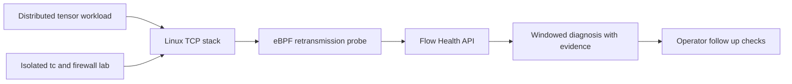

# High Speed Network Systems

Two practical, locally runnable projects for observing network behavior and understanding communication costs in distributed AI workloads. The code favors small modules, standard tools, explicit limitations, and tests that explain the expected behavior.

## Project map

| Project | What it demonstrates | Main implementation |
| --- | --- | --- |
| [Project 1: Flow Health Observatory](project1_flow_health_observatory/README.md) | Linux TCP retransmission capture, eBPF tracepoints, `tc` impairment labs, bounded telemetry ingestion, and evidence based diagnosis | Python 3 standard library and bpftrace |
| [Project 2: Collective Transport Lab](project2_collective_transport_lab/README.md) | Distributed tensor sum using ring reduce scatter and all gather over real TCP sockets, with exact per rank accounting | C++17 and a Python process launcher |

## System view



Project 1 adds visibility into a real TCP signal and shows how a controlled network impairment can be created inside dedicated namespaces. Project 2 creates repeatable multi process communication traffic and shows how a ring collective divides and circulates tensor chunks.

## Start here

### Project 1: inspect a retransmission burst

```bash
cd project1_flow_health_observatory
python3 -m flow_health.demo
python3 -m unittest discover -s tests -v
```

The synthetic demo starts a local API, submits a made up retransmission burst, and prints the diagnosis. Linux users can optionally connect the bpftrace probe to live kernel events; an isolated namespace lab demonstrates `tc` and `iptables` without changing host network rules.

### Project 2: run a 3 rank collective

```bash
cd project2_collective_transport_lab
python3 scripts/run_local.py --world-size 3 --elements 11
python3 -m unittest discover -s tests -v
```

Each rank is a separate C++ process. The result is an elementwise sum, checked by integration tests over loopback TCP.

## Build and test the whole repository

```bash
cd project1_flow_health_observatory
python3 -m unittest discover -s tests -v
bash -n tools/setup_netns_lab.sh tools/cleanup_netns_lab.sh

cd ../project2_collective_transport_lab
python3 -m unittest discover -s tests -v
```

GitHub Actions runs both suites on each pull request. The live eBPF capture and namespace impairment lab are optional Linux exercises; they need privileges and are not run in CI.

## Role alignment

| ByteDance role signal | Project evidence |
| --- | --- |
| Linux network programming and TCP/IP | Project 1 consumes TCP retransmission events; Project 2 uses framed TCP sockets across separate processes |
| Network monitoring, analysis, and diagnosis | Project 1 validates events, aggregates by flow, and returns a severity with threshold evidence |
| eBPF and Linux networking | Project 1 includes a bpftrace TCP tracepoint and an isolated `tc` and `iptables` network namespace exercise |
| High performance communication frameworks and AI workloads | Project 2 implements ring reduce scatter and all gather for tensor sums and accounts for sent bytes |
| Distributed systems and reliability | Project 2 handles partial reads, validates protocol headers, applies socket timeouts, and tests uneven partitions |
| C++ and Python | Project 2's transport is C++17 with a Python cluster launcher and integration tests; Project 1 uses Python |

The projects are focused demonstrations, not claims of production scale, RDMA, NCCL compatibility, or fleet performance. Both READMEs explain how to run the code, how each module works, what is tested, and what the prototypes do not cover.

## Layout

```text
project1_flow_health_observatory/
  flow_health/       telemetry model, event store, diagnosis, and API
  ebpf/              Linux TCP retransmission tracepoint
  tools/             probe forwarder and isolated namespace lab scripts
  tests/             validation, diagnosis, and API tests
project2_collective_transport_lab/
  src/               C++17 TCP ring all reduce
  scripts/           local compiler and multi process launcher
  tests/             multi rank correctness and input validation
.github/workflows/   continuous integration for both projects
```

## Pull request sequence

Project 1 is the base pull request. Project 2 is a stacked pull request based on Project 1 so the shared repository guide and CI workflow can evolve in a clear sequence.
