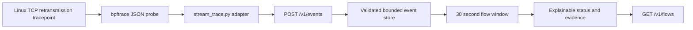
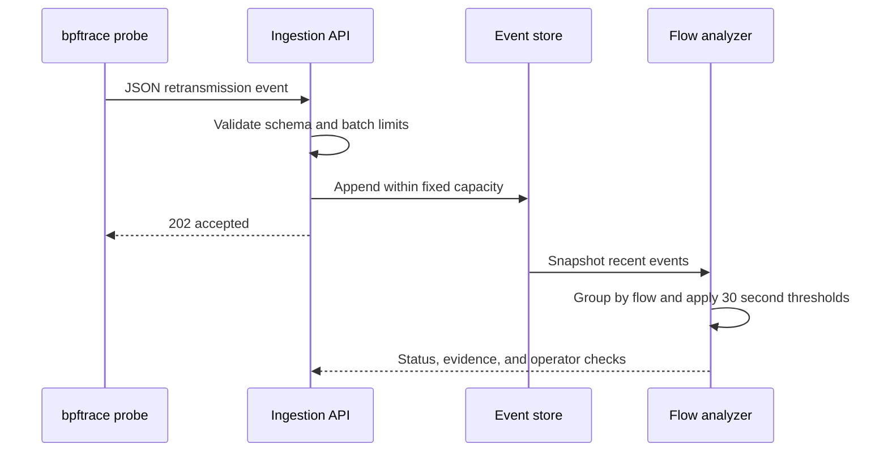

# Project 1: Flow Health Observatory

Flow Health Observatory turns TCP retransmission events into a small, evidence-linked diagnosis. It includes an optional Linux eBPF tracepoint, a JSON ingestion API, a bounded in-memory event store, deterministic threshold analysis, a synthetic demo, and tests that run without BPF privileges.

## Problem and design

When a distributed workload slows down, an operator needs to identify which flow is showing transport trouble and see the evidence behind the alert. This project narrows that workflow to one reliable kernel signal: TCP retransmissions. It groups events by address family and 4-tuple, evaluates a rolling time window, and returns a severity plus concrete follow-up checks.



The local demo substitutes generated events for the kernel probe, so the analysis path stays testable on macOS, Linux, and CI without elevated privileges.

## Repository guide

```text
flow_health/
  events.py       validated event schema and flow identity
  store.py        bounded, thread safe event storage
  analyzer.py     windowing, thresholds, evidence, and next checks
  server.py       dependency free HTTP API
  demo.py         end to end synthetic incident
ebpf/
  tcp_retransmit.bt   Linux TCP retransmission tracepoint
tools/
  stream_trace.py     bpftrace to HTTP adapter
  setup_netns_lab.sh  isolated veth pair with tc netem impairments
  cleanup_netns_lab.sh remove only the dedicated lab namespaces
samples/
  retransmission-burst.jsonl  representative trace events
tests/
  test_events.py     schema and validation tests
  test_analyzer.py   grouping, thresholds, and window tests
  test_server.py     HTTP integration tests
```

## Requirements and run

Python 3.9 or newer is required. The application and synthetic demo use only the Python standard library.

```bash
python3 -m flow_health.demo
```

To keep the API running in one terminal:

```bash
python3 -m flow_health.server --host 127.0.0.1 --port 8080
```

In another terminal, inspect readiness and the current view:

```bash
curl http://127.0.0.1:8080/health
curl http://127.0.0.1:8080/v1/flows
```

Run the full test suite:

```bash
python3 -m unittest discover -s tests -v
```

## API contract

`POST /v1/events` accepts one to 500 events in an `events` array. Each event has a monotonic nanosecond timestamp (matching bpftrace `nsecs`), address family, source and destination addresses, and source and destination ports.

```json
{
  "events": [
    {
      "event": "tcp_retransmit",
      "timestamp_ns": 1800000000000000000,
      "family": 2,
      "source_ip": "10.0.0.4",
      "source_port": 41000,
      "destination_ip": "10.0.1.9",
      "destination_port": 443
    }
  ]
}
```

The API returns `202 Accepted` with the accepted count. Malformed batches return `400`; unknown routes return `404`. Payloads are capped at 1 MB and batches at 500 records.

`GET /v1/flows` returns a list sorted with the most severe flows first. A flow is degraded after five retransmissions in the latest 30 second window and critical after twenty. Each non healthy result includes the observed count, the threshold, the time window, and suggested checks. Thresholds can be changed when creating `FlowAnalyzer`.

## Live Linux capture

The capture script uses the kernel `tcp_retransmit_skb` tracepoint and bpftrace's `ntop` helper to emit JSON records. It requires Linux, `bpftrace`, and permission to attach BPF probes. It may require `sudo` depending on the host configuration.

Terminal 1:

```bash
python3 -m flow_health.server --host 127.0.0.1 --port 8080
```

Terminal 2, from this project directory:

```bash
sudo python3 tools/stream_trace.py --api http://127.0.0.1:8080
```

Generate ordinary TCP traffic in another terminal and inspect `/v1/flows`. Kernel tracepoint fields and BPF permissions vary by Linux distribution and kernel configuration. The synthetic demo is the portable baseline when live tracing is unavailable.

### Optional isolated `tc` and firewall lab

On a disposable Linux host with `iproute2`, `iptables`, and root privileges, create two dedicated network namespaces joined by a veth pair:

```bash
sudo bash tools/setup_netns_lab.sh
```

The script applies delay and loss only to the lab interface using `tc netem`. To add a destination port drop inside the isolated source namespace, set `FLOWLAB_DROP=1` when creating the lab. Then run your own test client inside `flowlab-a` and a test server inside `flowlab-b` using `ip netns exec`. These rules do not change the host's default namespace. Remove the lab when finished:

```bash
sudo bash tools/cleanup_netns_lab.sh
```

The setup refuses to overwrite existing namespaces with the same dedicated names. Review the script and chosen impairment values before running it.

## Diagnosis flow



## Reliability and security choices

- The HTTP server binds to loopback by default and has no authentication; do not expose it to an untrusted network.
- Input sizes, batch sizes, port ranges, address strings, and event types are validated before storage.
- The deque has a fixed capacity, so memory use does not grow without bound.
- Responses are JSON, contain no secrets, and are marked `no-store`.
- The diagnosis is deterministic and includes the threshold evidence that triggered it.
- The optional traffic impairment lab confines `tc` and `iptables` changes to named network namespaces and a veth pair.
- The server uses a lock around shared event state and a threaded HTTP server for concurrent local clients.

## Limits and next steps

This project deliberately reports a retransmission burst, not a complete root cause. It does not infer one way loss, estimate throughput, correlate interface drops, or persist events across restarts. A production extension could add per interface counters, RTT samples, an eBPF ring buffer loader, durable storage, authentication, and alert routing. Each added signal should retain explicit evidence and tests.
