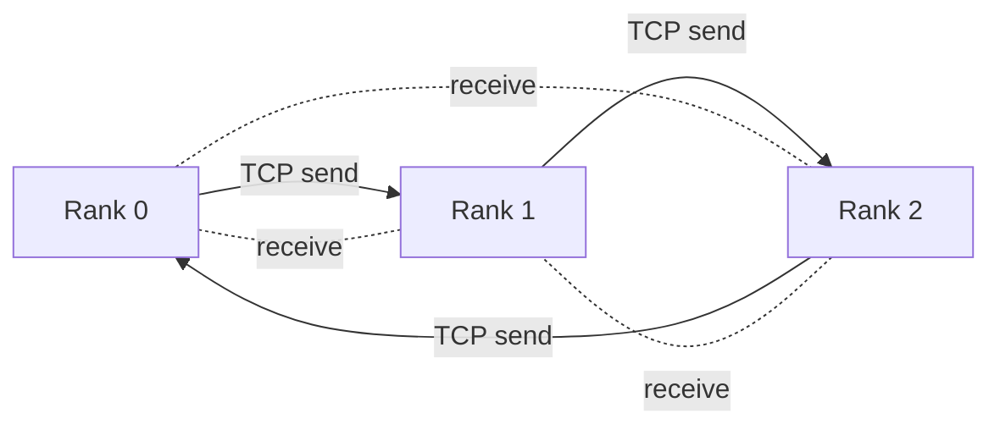
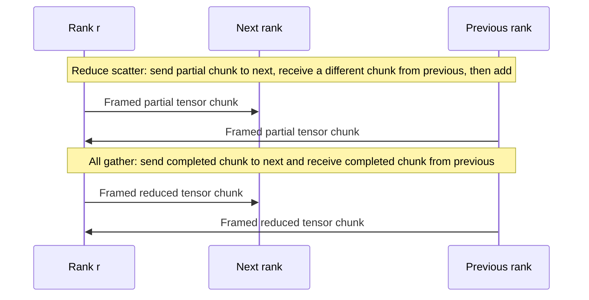

# Project 2: Collective Transport Lab

Collective Transport Lab implements a small distributed tensor sum using two standard ring phases: reduce scatter and all gather. Each rank is a separate C++17 process, communicates with its two neighbors over TCP, and produces the same reduced tensor. The Python launcher builds and starts a local cluster; the integration tests check real socket communication, tensor partitioning, framing, and results.

## Why this project

AI training and inference workloads exchange large tensors between workers. Collective communication libraries such as MPI and NCCL hide the details, but performance work still depends on understanding message volume, topology, framing, and failure modes. This project makes those pieces visible in a compact implementation that can run on one computer.

The transport is ordinary TCP over loopback. It is a teaching and measurement harness, not an RDMA implementation or a replacement for MPI or NCCL.

## Architecture



Each rank holds the same sized input tensor, initialized to `rank + 1`. The ring first combines chunks with reduce scatter, then circulates each completed chunk with all gather. On completion, every rank holds the elementwise sum of all rank inputs.



Frames use a fixed header with a magic value, phase, step, chunk index, and element count. Header fields and double values are encoded in network byte order. The receiver validates each header before accepting the tensor data. Sends and receives run concurrently per step so large frames do not deadlock when a socket send buffer fills.

## Repository guide

```text
src/ring_allreduce.cpp       TCP transport, framing, ring algorithm, and CLI
scripts/run_local.py         compiler wrapper and multi-process local launcher
tests/test_distributed.py    correctness and argument validation tests
Makefile                     build, test, demo, and clean targets
```

## Requirements and run

- C++17 compiler (`clang++` or `g++`).
- Python 3.9 or newer for the launcher and test harness.
- A local environment that permits loopback TCP sockets for multi-rank tests.

Run three local ranks with an uneven 11 element tensor:

```bash
python3 scripts/run_local.py --world-size 3 --elements 11
```

The launcher compiles the C++ binary into `build/` and prints one JSON result per rank, including checksum, first and last element, elapsed collective time, and bytes sent. To choose an explicit consecutive port block:

```bash
python3 scripts/run_local.py --world-size 3 --elements 100000 --base-port 28000
```

Each process can also be started by hand:

```bash
make build
./build/ring_allreduce --rank 0 --world-size 3 --base-port 28000 --elements 11
./build/ring_allreduce --rank 1 --world-size 3 --base-port 28000 --elements 11
./build/ring_allreduce --rank 2 --world-size 3 --base-port 28000 --elements 11
```

For real use, start each process in its own terminal or on separate hosts with a reachable interface; this example binds to loopback for safety and repeatability.

## Tests

```bash
python3 -m unittest discover -s tests -v
```

The tests compile with strict warnings, run three and four process clusters, verify exact sums for uneven and empty chunks, exercise the one rank case, and ensure invalid rank arguments fail before opening sockets. The socket tests need permission to bind loopback ports.

## Complexity and measurement

For `P` ranks and `N` values, each phase takes `P - 1` ring steps. Each rank sends all but one tensor chunk in reduce scatter and again in all gather, for approximately `2(P - 1)N/P` payload values sent per rank. The exact byte counter includes the fixed frame headers. The per-rank `elapsed_us` measures the collective phase after ring connections are established; the Python launcher's wall time also includes process startup.

Loopback timings are useful for checking correctness and message accounting, not for claiming data center throughput. Real performance depends on NICs, congestion, CPU scheduling, topology, and transport offloads.

## Failure handling and boundaries

- The ring uses connect retries and bounded socket send and receive timeouts to avoid silent hangs.
- Every message is checked for the expected phase, step, chunk, and size before values are accepted.
- The demo binds only to `127.0.0.1`; it does not expose a remote service.
- The implementation uses the operating system TCP stack and default congestion control.
- There is no GPU support, RDMA, fault-tolerant rank recovery, authentication, or production scheduler integration.

These boundaries keep the algorithm and transport readable while giving a sound base for adding topology-aware placement, concurrent chunk pipelining, a second transport, or hardware measurements.
